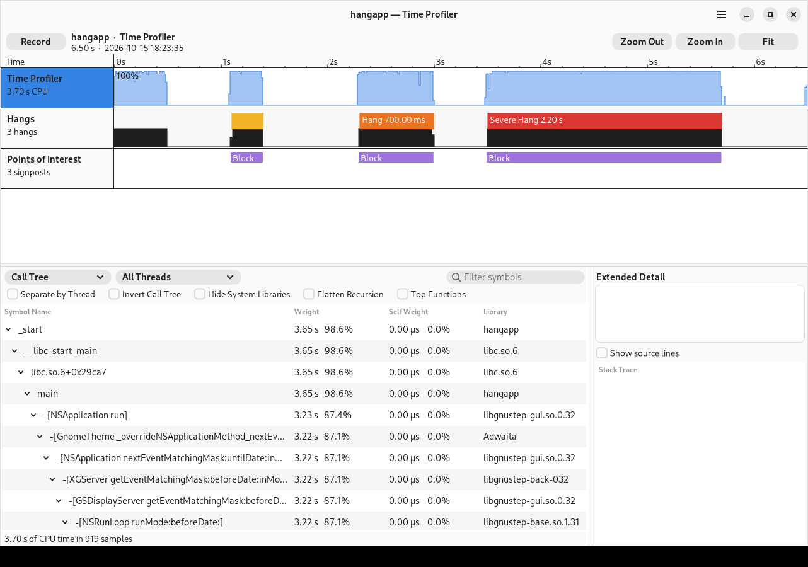
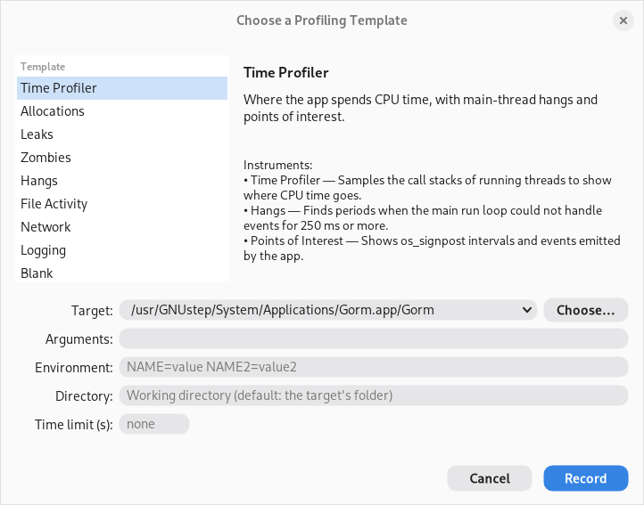
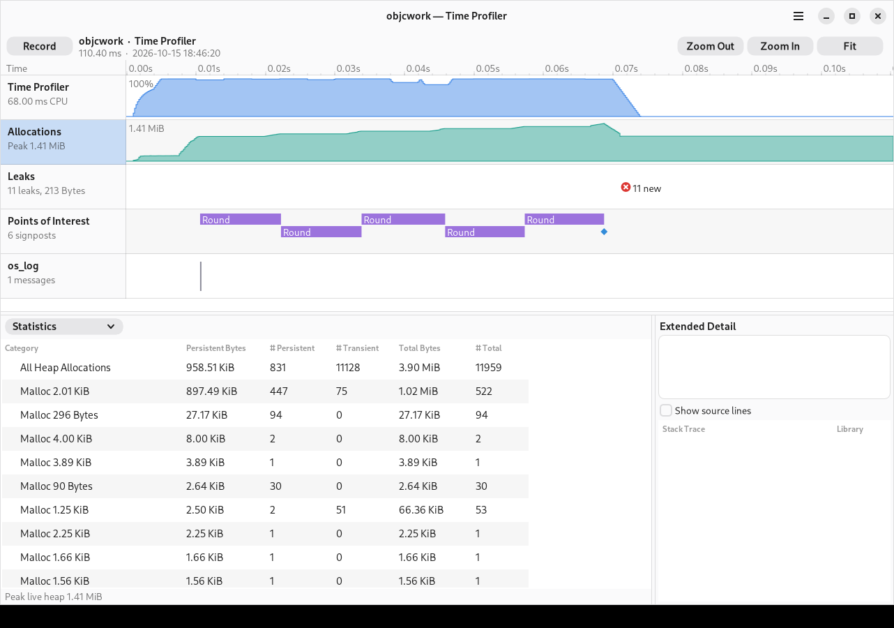
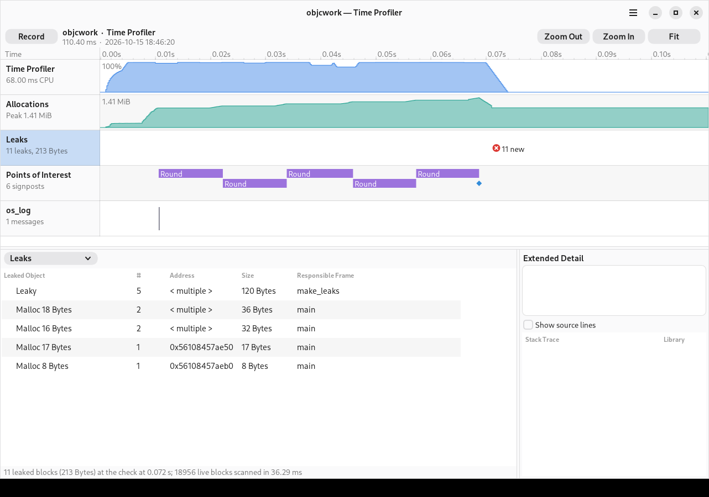
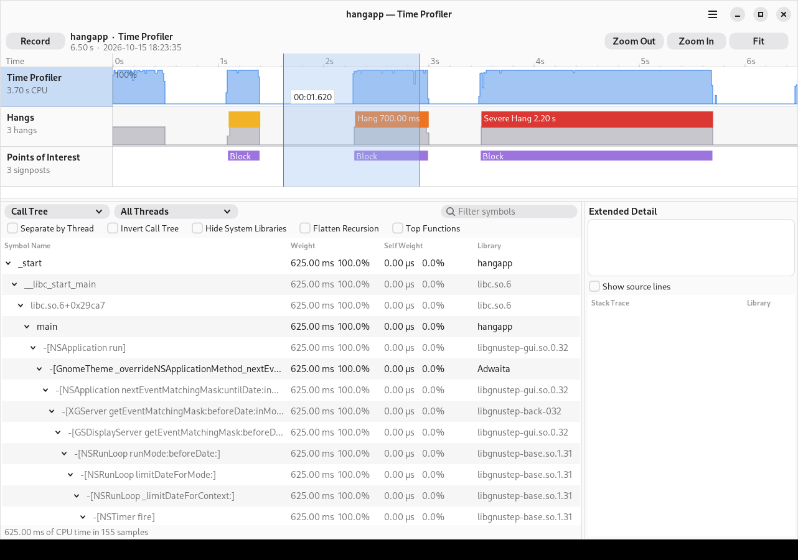
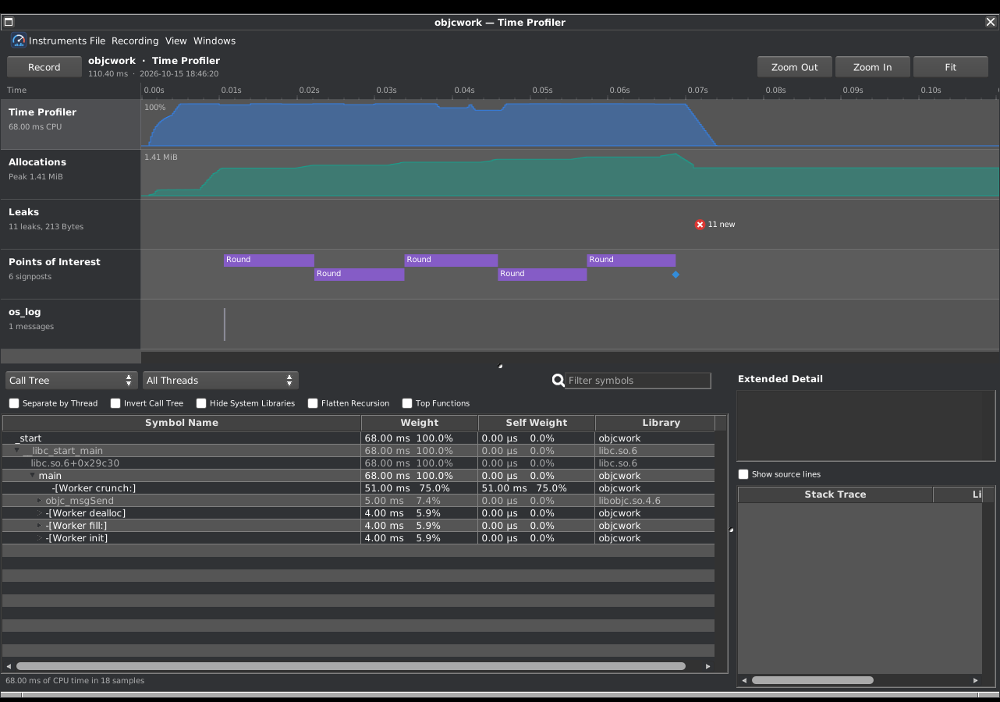

# GNUstep Instruments

A performance analysis tool for GNUstep applications, modelled on Apple's
Instruments: record a program, then explore where its time and memory go on a
timeline of tracks, with call trees, allocation statistics, leak checks,
signposts and hang detection.



It has three parts:

- **Instruments.app** — the GNUstep AppKit front end: choose a template and a
  target, record, and analyse. Works with any GNUstep theme (Adwaita on Linux,
  WinUITheme on Windows are the defaults the release packages ship).
- **gstrace** — the command-line equivalent of `xctrace`: record, report,
  export and symbolicate traces, for scripts and CI.
- **libgsperf** — `os_signpost` / `os_log` for GNUstep (`<os/signpost.h>`,
  `<os/log.h>`), so applications can mark intervals that show up as Points of
  Interest.

Status: Linux (x86_64). Windows is planned (see
[docs/windows.md](docs/windows.md)). Not yet released; see
[docs/release.md](docs/release.md).

## Instruments

| Instrument | What it records |
|---|---|
| Time Profiler | Call stacks of running threads, sampled every 1 ms of CPU time. Call tree with Separate by Thread, Invert Call Tree, Hide System Libraries, Flatten Recursion, Top Functions, plus charge-to-caller, prune and focus. |
| Hangs | Main-thread wall-clock samples; finds periods of 250 ms or more when the run loop could not handle events (Microhang / Hang / Severe Hang) and the stack responsible. |
| Points of Interest | `os_signpost` intervals and events. |
| os_log | `os_log` messages. |
| Allocations | Every `malloc`/`calloc`/`realloc`/`free` with its call stack; Objective-C instances are labelled with their class. Statistics (persistent / transient), allocation list, call trees, live-heap graph. |
| Leaks | Periodic conservative heap scans (stop-the-world) reporting unreachable blocks, including retain cycles, with their allocation stacks. |
| Zombies | `NSZombieEnabled` plus retain/release history: which deallocated object received which message, and its malloc/retain/release history. |
| File Activity | Every open, read, write, sync and close on files (POSIX calls, their `_FORTIFY_SOURCE` variants and stdio), with duration, bytes, errors and call stack; per-file summaries and a duration-weighted call tree. |
| Network | Connections (with peer addresses) and bytes sent and received per peer, with call stacks. |
| System Time Profiler | Attach to a running process and sample it with `perf_event`, including kernel stacks (needs the profiling helper, see below). |

Templates combine them: Time Profiler, Allocations, Leaks, Zombies, Hangs,
File Activity, Network, Logging, System Time Profiler and Blank (`gstrace list templates`).

## Building

In a shell where `GNUstep.sh` has been sourced (clang and libobjc2):

```sh
make             # runtime, framework, gstrace, gstrace-helper, Instruments.app
make check       # unit tests (tools-xctest) and end-to-end recordings
make install     # GNUstep Local domain; honours DESTDIR
```

The unit tests need [tools-xctest](https://github.com/danjboyd/tools-xctest);
the end-to-end suite runs the AppKit fixture under `Xvfb` when it is available
(`SKIP_GUI=1` skips it).

## Using the app



Launch `Instruments.app`, pick a template, choose the program to record
(an `.app` bundle or any executable) and press **Record**. The timeline fills
in live; **Stop** ends the target. Click a track to see its details below;
drag on the timeline to set an inspection range that filters the details;
select a row to see its stack in Extended Detail.

Traces are directory bundles (`*.gstrace`). Recordings go to a temporary
folder until you **Save As…**; **Export…** writes JSON, Chrome/Perfetto
traces, speedscope profiles, folded stacks or CSV.

| | |
|---|---|
|  |  |
|  |  |

## Using gstrace

```sh
gstrace record --template "Time Profiler" --launch ./MyApp.app/MyApp
gstrace record --template Leaks --time-limit 30s -o leaks.gstrace -- ./tool --flag
gstrace record --attach 4242 --time-limit 10s         # System Time Profiler

gstrace info trace.gstrace
gstrace report trace.gstrace top                       # Top Functions
gstrace report trace.gstrace calltree --invert --hide-system --min-percent 1
gstrace report trace.gstrace hangs --lines             # with source lines
gstrace report trace.gstrace allocations [--by-stack --persistent]
gstrace report trace.gstrace leaks [--by-stack]
gstrace report trace.gstrace signposts --limit 20
gstrace report trace.gstrace zombies
gstrace report trace.gstrace files [--events | --by-stack]
gstrace report trace.gstrace network [--events]

gstrace export trace.gstrace --format chrome -o trace.json    # Perfetto UI
gstrace export trace.gstrace --format speedscope -o p.speedscope.json
gstrace export trace.gstrace --format collapsed | flamegraph.pl > fg.svg
gstrace export trace.gstrace --format csv --table allocations

gstrace symbolicate trace.gstrace --embed   # store symbol names in the bundle
```

`--range 1.5-3.0` (seconds) and `--thread <tid>` restrict reports.

## Signposts

```objc
#include <os/signpost.h>

static os_log_t poi;
poi = os_log_create("com.example.app", OS_LOG_CATEGORY_POINTS_OF_INTEREST);

os_signpost_id_t spid = os_signpost_id_generate(poi);
os_signpost_interval_begin(poi, spid, "Load", "file %s", name);
...
os_signpost_interval_end(poi, spid, "Load");
os_signpost_event_emit(poi, OS_SIGNPOST_ID_EXCLUSIVE, "Checkpoint");
os_log(OS_LOG_DEFAULT, "loaded %d items", n);
```

Link with `-lgsperf`. When the program is not being recorded these calls do
nothing, so they can stay in release builds.

## Privileges

Recording a program you launch needs no privileges: the agent is loaded into
the target with `LD_PRELOAD` and samples it from the inside. (Set-uid and
file-capability binaries ignore `LD_PRELOAD`; Instruments says so.)

Attaching to a running process uses the kernel's `perf_event`, which Debian
restricts (`kernel.perf_event_paranoid` = 3). Either

- install the profiling helper once — **Instruments ▸ Install Profiling
  Helper…** or `gstrace install-helper` — which asks for an administrator
  password through polkit, installs `/usr/local/libexec/gstrace-helper` with a
  polkit policy, and is then used through `pkexec` on demand (kernel stacks
  included); or
- set `kernel.perf_event_paranoid` to 2 or lower to sample your own processes
  without the helper (user-space stacks only).

The helper only samples processes whose user and group ids are all the
invoking user's (so not setuid programs), stops if the target execs another
program, writes only into a trace bundle that user owns (mode 0600, since it
contains kernel addresses), and never records for more than an hour. The
installed copy cannot reinstall or remove itself; `gstrace uninstall-helper`
removes it (again through an administrator password).

## Overhead

Measured on a small Objective-C program (82 ms unrecorded; figures include
about 50 ms of `gstrace` start-up): Time Profiler 141 ms, Zombies 132 ms,
Allocations 164 ms, Leaks 199 ms. Allocation recording costs about 165 ns
per allocation (mostly stack unwinding); a leak check of a GNUstep GUI app
(145,000 live blocks) pauses it for about 0.4–1.4 s.

## How it works

See [docs/architecture.md](docs/architecture.md) for the design and
[docs/trace-format.md](docs/trace-format.md) for the on-disk format.
In short: `libgsperf-agent.so` (plain C, depends only on libc) interposes
`malloc`, `pthread_create`, `exit` and a few Objective-C runtime entry points,
samples threads with per-thread CPU-time timers and unwinds with libunwind,
and streams records into per-thread lock-free rings that a writer thread
drains to `events-<pid>.bin`. `libGSPerformance` reads traces, symbolicates
(ELF symbols, `.eh_frame` function bounds, the Objective-C method table the
agent dumps, separate debug files) and runs the analyses that both the app
and `gstrace` use.

## Limitations

- Linux x86_64 only for now; Windows is planned.
- Statically linked programs cannot be recorded by launching (no
  `LD_PRELOAD`); use attach.
- Leak detection is conservative: a stale pointer-sized value can keep a
  leaked block alive (a missed leak), and pointers hidden by encodings the
  scanner does not understand can produce false reports. Objective-C objects
  are matched strictly (only pointers to the object count), so leaked
  objects and retain cycles are found reliably; leaks of plain C blocks in
  programs that churn the heap may be missed, as with any conservative
  scanner. Self-relative offsets of the kind fontconfig uses are followed.
- The System Time Profiler uses frame-pointer call chains from the kernel;
  code built without frame pointers shows shallow stacks there.
- Retain/release history covers `objc_retain`/`objc_release`/
  `objc_autorelease` and the messages that reach them.

Known upstream issues found while building this are listed in
[docs/upstream-issues.md](docs/upstream-issues.md).

## License

GNU LGPL 2.1 or later, like GNUstep's libraries (see `COPYING.LIB`).
